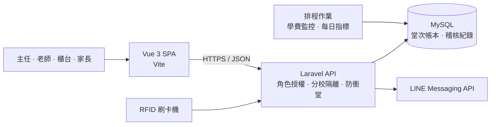

<div align="center">


# AllTrue 補習班營運管理系統

**排課、點名、扣堂、評量、帳務與家長 LINE 溝通，集中在同一套系統。**

[文件索引](docs/INDEX.md) · [系統技術指引](docs/SYSTEM_TECH_GUIDE.md) · [維運手冊](docs/OPERATIONS_RUNBOOK.md) · [事故應變](docs/INCIDENT_START_HERE.md)

</div>

AllTrue 是給多校區補習班使用的營運平台，目前已在正式環境運作。主任、老師、櫃台與家長各有自己的工作台，每天只先看到需要處理的事。

*AllTrue is a production operations platform for multi-campus tutoring centers. It unifies scheduling, attendance, lesson-credit deduction, learning records, billing, and LINE parent messaging.*

> [!IMPORTANT]
> 本儲存庫不存放任何正式環境憑證、金鑰或真實學童個資，也不收錄含真實資料的畫面截圖。發現安全問題請依 [`SECURITY.md`](SECURITY.md) 通報，不要開公開 Issue。

## 功能

| 領域 | 內容 |
|---|---|
| 多校區 | 依授權切換分校；後端強制隔離各分校的學生、課表與帳務資料 |
| 學生與合約 | 學籍、家長聯絡人、RFID 卡綁定；單堂、套裝、多生共約與試聽方案 |
| 排課 | 週行事曆與日課表；排課時檢查學生重複、老師跨校衝堂與教室容量 |
| 師資與代課 | 授課資格、可用時段、鐘點費率；代課派任與跨校調度 |
| 出勤 | RFID 刷卡與手動點名，出席即時連動合約扣堂 |
| 請假與補課 | 家長線上請假；系統推薦補課時段，主任核准或退回 |
| 學習評量 | 老師課後填寫，主任審核後才發布給家長 |
| 帳務 | 應收帳款、逾期提醒、繳費單與收據、各分校當月學收試算 |
| 家長端 | LINE 綁定；到校／離校通知、課表、評量與剩餘堂數 |
| 異常回報 | 老師一鍵回報「現場與系統不符」，主任處理並留下稽核紀錄 |

### 使用角色

| 角色 | 每天主要在做什麼 |
|---|---|
| 分校主任 | 營運巡檢、審請假與評量、追未繳學費、處理課表異常 |
| 老師 | 上下課打卡、點名、填評量、看跨校課表 |
| 櫃台 | 學生刷卡、現場登記出缺席、收費入帳與列印單據 |
| 家長 | 收 LINE 通知、請假、看評量與帳務 |

> [!NOTE]
> 同一儲存庫也包含開發中的 **TrueFit 學習工作台**（功能旗標關閉，尚未上線）。紙本考卷上傳、OCR 與 AI 診斷**尚未實作**。實際狀態以 [`docs/truefit/PROGRAM_STATUS.md`](docs/truefit/PROGRAM_STATUS.md) 為準；產品邊界見 [`docs/truefit/PRODUCT_ARCHITECTURE_BRIEF.md`](docs/truefit/PRODUCT_ARCHITECTURE_BRIEF.md)。

## 系統架構



| 層 | 技術 |
|---|---|
| 前端 | Vue 3、Vite、Vitest、Playwright |
| 後端 | Laravel 8、PHP 8.2（正式環境 8.2.35）、PHPUnit、PHPStan |
| 資料庫 | MySQL 8.0 |
| 整合 | LINE Messaging API、RFID 刷卡 |
| CI / 部署 | GitHub Actions；正式部署只走 [`deploy.yml`](.github/workflows/deploy.yml)（發車班表 + 自動部署最新一個綠燈 commit） |

架構細節見 [`docs/architecture/README.md`](docs/architecture/README.md) 與 [`docs/CONTROL_PLANE_CONTRACT.md`](docs/CONTROL_PLANE_CONTRACT.md)。

## 快速開始

需要：PHP 8.2 與 Composer、Node.js 22、MySQL 8.0。

```bash
git clone https://github.com/jerry200176-png/AllTrue_System.git
cd AllTrue_System

# 後端
cd backend
cp .env.example .env
composer install
php artisan key:generate
php artisan migrate

# 前端
cd ../frontend
npm install
npm run dev
```

> [!CAUTION]
> 本地只能連本機資料庫。`php artisan test` 會清空資料庫，**絕對不要**對正式環境或正式資料庫執行任何測試或 migration。

## 提交前檢查

```bash
cd backend && php artisan test                 # 後端測試（只連本機 DB）
cd ../frontend && npm run test:unit            # 前端單元測試
npm run build                                  # 含多項契約測試的正式建置
cd .. && node scripts/docs-integrity-check.mjs --strict
node scripts/control-plane-lint.mjs
```

PR 開啟後，CI 會再跑 PHPStan、建置、Gitleaks 機敏掃描、OSV-Scanner／CodeQL 與文件完整性檢查。

## 如何貢獻與交付

1. 從最新 `origin/main` 開 `feat/`、`fix/`、`chore/`、`docs/` 等前綴分支（[`CONTRIBUTING.md`](CONTRIBUTING.md)）；一個 session 一個分支，雲端 session 為預設（2026-10-14 起），`agent-start`、Exo 與固定 07:30／12:30 合併班次已退役（[`WORKTREE_POLICY`](docs/governance/WORKTREE_POLICY.md)）。
2. 開 PR 並依 [PR 範本](.github/pull_request_template.md) 宣告 `Risk-Class`（R0–R3）與 `**Rollback:**`；碰 `backend/app/`、`backend/routes/`、`frontend/src/` 時新增 `docs/changes/<date>-<slug>.md` fragment（教職員版本卡或 `silent_ship` 例外，見 [`GUIDE_STAFF_UPDATES`](docs/GUIDE_STAFF_UPDATES.md)）。
3. CI 全綠後加上 label `queue`，由 [`land-queue.yml`](.github/workflows/land-queue.yml)（自建合併佇列）更新分支並合併；`main` 受保護，只能透過 PR 合併。
4. 合併後 `deploy.yml` 依風險分類部署：R0–R2 自動；需 Founder 核准者搭「發車班表」。部署後自動檢查健康端點與版本 SHA，保有 20 分鐘觀察、自動回滾與備份復原程序。
5. 正式資料修復（POP）只走已審查的 workflow 並留稽核紀錄；現況與常見坑見 [`docs/RUNBOOK_HANDOFF.md`](docs/RUNBOOK_HANDOFF.md)，POP 規格見 [`docs/pop/`](docs/pop/)。

「程式寫好」不等於「已上線」：程式 → 測試 → PR → CI 全綠 → 合併 → 受控部署 → 線上驗證 → 正式驗收。

> [!TIP]
> **AI 加速實作，證據決定完工。** AI 可以寫程式和測試，但「AI 說做完了」不算驗收；完工要靠測試、CI 與線上證據。AI 代理人的工作規範見 [`AGENTS.md`](AGENTS.md)。

## 開源致謝 Built with

AllTrue 站在下列成熟開源專案之上（僅列直接依賴與實際使用的 CI 工具；版本取自 `composer.lock`／`package-lock.json`／workflow pin，授權取自套件 metadata）。

| 領域 | 專案 | 版本 | 授權 | 用途 |
|---|---|---|---|---|
| 後端 | [Laravel](https://laravel.com) | 8.x | MIT | API 框架、ORM、排程 |
| 後端 | [Laravel Sanctum](https://github.com/laravel/sanctum) | 2.15 | MIT | API token 驗證 |
| 後端 | [Laravel Tinker](https://github.com/laravel/tinker) | 2.11 | MIT | 維運用 REPL |
| 後端 | [Guzzle](https://github.com/guzzle/guzzle) | 7.x | MIT | 呼叫 LINE 等外部 HTTP API |
| 後端 | [Laravel Excel](https://github.com/SpartnerNL/Laravel-Excel) | 3.1 | MIT | 學生課程、教師出勤的匯入匯出 |
| 後端／前端 | [Sentry](https://github.com/getsentry/sentry-php)（`sentry-laravel` 4.x、`@sentry/vue` 10.x） | 4 / 10 | MIT | 錯誤追蹤 |
| 前端 | [Vue 3](https://github.com/vuejs/core) | 3.5 | MIT | SPA 框架 |
| 前端 | [Vite](https://github.com/vitejs/vite) + `@vitejs/plugin-vue` | 6 / 6 | MIT | 開發伺服器與建置 |
| 前端 | [modern-screenshot](https://github.com/qq15725/modern-screenshot) | 4.7 | MIT | 繳費單／收據轉圖片 |
| 前端 | [culori](https://github.com/Evercoss/culori) | 4.x | MIT | 設計 token 色彩對比測試 |
| 測試 | [PHPUnit](https://github.com/sebastianbergmann/phpunit) | 9.6 | BSD-3-Clause | 後端單元／功能測試 |
| 測試 | [Mockery](https://github.com/mockery/mockery) · [Faker](https://github.com/FakerPHP/Faker) · [Collision](https://github.com/nunomaduro/collision) | 1.6 / 1.24 / 5.11 | BSD-3-Clause / MIT / MIT | 測試替身、假資料、CLI 錯誤輸出 |
| 測試 | [Vitest](https://github.com/vitest-dev/vitest)（含 coverage-v8） · [Vue Test Utils](https://github.com/vuejs/test-utils) · [jsdom](https://github.com/jsdom/jsdom) | 4 / 2.5 / 29 | MIT | 前端單元與元件測試 |
| 測試 | [Playwright](https://github.com/microsoft/playwright) | 1.64 | Apache-2.0 | UI smoke／E2E |
| 測試 | [axe-core Playwright](https://github.com/dequelabs/axe-core-npm) | 4.14 | MPL-2.0 | 無障礙自動檢查 |
| 品質 | [PHPStan](https://github.com/phpstan/phpstan) | 2.x | MIT | 後端靜態分析 |
| 品質 | [ESLint](https://github.com/eslint/eslint) + `eslint-plugin-vue`／`-vuejs-accessibility` | 9 / 10 / 2 | MIT | 前端 lint 與無障礙規則 |
| 品質 | [Husky](https://github.com/typicode/husky) · [lint-staged](https://github.com/lint-staged/lint-staged) | 9 / 16 | MIT | commit 前檢查 |
| 資安／CI | [Gitleaks](https://github.com/gitleaks/gitleaks) | 8.18.4 | MIT | 機敏資訊掃描（`secret-scan.yml`） |
| 資安／CI | [OSV-Scanner](https://github.com/google/osv-scanner)（`osv-scanner-action` 2.6） | 2.x | Apache-2.0 | 每週相依套件弱點深掃 |
| 資安／CI | [CodeQL](https://github.com/github/codeql) | — | MIT（查詢集） | 靜態程式碼安全分析 |
| 資安／CI | [dorny/paths-filter](https://github.com/dorny/paths-filter) · [shivammathur/setup-php](https://github.com/shivammathur/setup-php) · [actions/*](https://github.com/actions) | 4 / 2.40 / — | MIT | workflow 變更偵測、PHP 環境、checkout 與 artifact |
| 維運 | [MemPalace](docs/MEMPALACE_OPERATIONS_HANDBOOK.md) | — | 未於 repo 記載 | 非正式環境、僅本機的輔助記憶系統，無任何正式環境權限 |

授權以各專案官方儲存庫為準；本專案自身為專有授權（[`LICENSE.md`](LICENSE.md)）。

## 目錄結構

| 路徑 | 內容 |
|---|---|
| `frontend/` | Vue 3 前端 |
| `backend/` | Laravel API、migration 與測試 |
| `operations/` | 版本化的維運型錄與修正腳本 |
| `scripts/` | 治理、CI 檢查、健康驗證與備份工具 |
| `docs/` | 架構、SOP、決策紀錄與事故檢討 |
| `.github/workflows/` | CI、安全掃描、部署與正式環境驗證 |

## 延伸閱讀

- [文件總覽 `docs/INDEX.md`](docs/INDEX.md)：所有文件的導航地圖
- [部署指引](docs/DEPLOYMENT.md) · [高風險維運清單](docs/DANGEROUS_OPERATIONS.md) · [維運型錄](operations/catalog.yaml)
- [交接狀態](docs/RUNBOOK_HANDOFF.md)：進行中的工作、部署與 POP 常見坑
- [MemPalace 本地輔助系統](docs/MEMPALACE_OPERATIONS_HANDBOOK.md)：MemPalace is a non-production, best-effort local system. It has no incident authority, no SLO, and no execution impact on production.
- 貢獻規範：[`CONTRIBUTING.md`](CONTRIBUTING.md) · 授權：[`LICENSE.md`](LICENSE.md)
